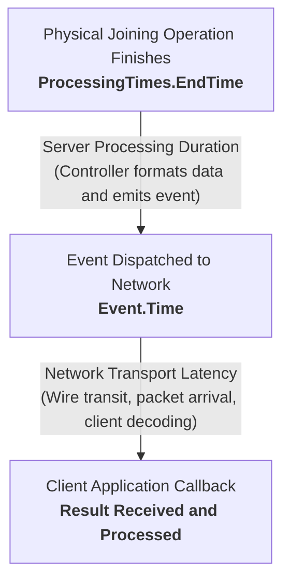
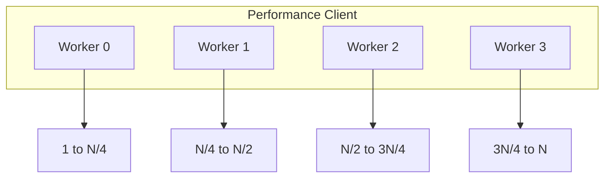
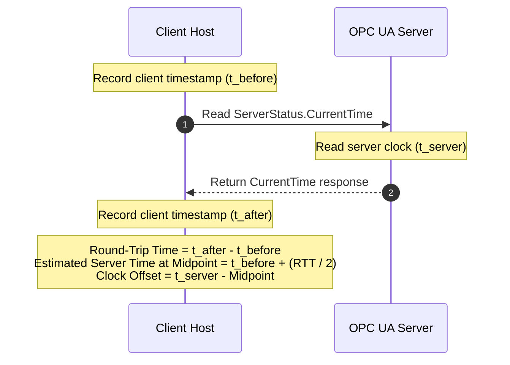

# Industrial Joining Technologies (IJT) — Performance and Benchmarking Guide

This is the full model of the **IJT Performance Client**, for people and for tools.

- People who only need a command start at the [README](../README.md).
- Tools that need the engineering contract also read [SKILLS](SKILLS.md).
- This guide keeps the shared detail: formulas, claim rules, worker math, integrity statuses, commands, and file names.
- A later section often repeats a fact next to the command that uses it.

Two sections are architecture, and they stay, because they change what a number means:

- [Section 3](#3-concurrency-architecture-and-process-sharding) — one worker process per slice of servers. A one-computer fleet measures that computer, not the factory network.
- [Section 4](#4-clock-offset-skew-calibration) — clock offset between the server and the client. Uncorrected clocks distort the time.

| Section | What it is for |
|---|---|
| [1. Total Result Transfer Time](#1-understanding-total-result-transfer-time) | What the delivery time is |
| [2. Timing Breakdown](#2-standardized-timing-breakdown) | Each stage, its formula, and its code name |
| [2b. Claims, Roles, Inventory](#2b-claim-profiles-roles-and-fleet-inventory) | Profile A / B, roles, inventory, session defaults |
| [3. Workers](#3-concurrency-architecture-and-process-sharding) | Why the client uses processes, and the worker formula |
| [4. Clock Offset](#4-clock-offset-skew-calibration) | How the two clocks are lined up |
| [5. Reading a Report](#5-interpreting-benchmark-reports-and-diagnostics) | Time band, action, percentiles, cause table |
| [6. Commands](#6-practical-execution-scenarios) | Copy-paste runs, limits, integrity gate |
| [7. Files](#7-export-formats-and-cicd-integration) | Console, Markdown, JUnit, JSON, CSV |
| [8. Cadence](#8-joining-cadence-and-operation-interval) | `--burst-delay` |
| [9. Glossary](#9-glossary) | Report words next to JSON and CSV keys |

---

## 1. Understanding Total Result Transfer Time

### Purpose and Overview

A joining system finishes an operation. Examples: a tightening spindle, a riveting press, a clinching tool, an adhesive dispenser.

The controller then records:

- measured values (torque, angle, force, or stroke)
- physical timestamps
- status (OK / NOK)

That result travels across the factory network to quality databases, manufacturing software, and automation systems before the next production step.

**Total Result Transfer Time (`total_result_transfer_time_ms`)** is that delivery time:

> From `ProcessingTimes.EndTime` (joining completes) to the client receiving, decoding, and processing `JoiningSystemResultReadyEvent`.



### Operational Impact on Manufacturing Lines

1. **Station Cycle Time:** Assembly stations frequently run on cycles of 30 to 60 seconds. Delivery delays stall automation handshakes and create line bottlenecks.
2. **Immediate Quality Feedback:** Rapid result delivery ensures defective joints are detected before assemblies move downstream.
3. **Scale Stability:** One tool at 50 ms can look fine alone. Dozens or hundreds of systems emitting together still need the network and the client to keep up, without dropped events or extra buffering delay.

---

## 2. Standardized Timing Breakdown

To isolate bottlenecks, the IJT standard decomposes Total Result Transfer Time into distinct, measurable stages:

$$\text{Total Result Transfer Time} = (T_{\text{client}} - T_{\text{end}}) + \Delta t_{\text{skew}} = T_{\text{server}} + T_{\text{network}}$$

| Metric | Code Variable | Formula | OPC UA Source Field | Operational Target |
|---|---|---|---|---|
| **1. Joining Duration** | `joining_duration_ms` | $T_{\text{end}} - T_{\text{start}}$ | `ProcessingTimes.EndTime` minus `ProcessingTimes.StartTime` | Process-dependent (typically 200 ms to 2,000 ms) |
| **2. Server Processing Duration** | `server_processing_time_ms` | $T_{\text{event}} - T_{\text{end}}$ | `Event.Time` minus `ProcessingTimes.EndTime` | **< 30 ms** |
| **3. Network Transport Latency** | `network_transport_time_ms` | $(T_{\text{client}} - T_{\text{event}}) + \Delta t_{\text{skew}}$ | Client receive time minus `Event.Time` plus clock skew | **< 40 ms** |
| **4. Total Result Transfer Time** | `total_result_transfer_time_ms` | $(T_{\text{client}} - T_{\text{end}}) + \Delta t_{\text{skew}}$ | Client receive time minus `ProcessingTimes.EndTime` plus clock skew | **< 100 ms** (Target for real-time tracking) |

*All cross-clock timing calculations incorporate clock drift calibration ($\Delta t_{\text{skew}}$) to ensure physical elapsed durations remain accurate.*

### Client-Side Measurement Points (Headline Metric)

$T_{\text{client}}$ includes time the result waits in the client's own event loop.

Two earlier timestamps separate the network from the client:

| Timestamp | Taken when |
|---|---|
| $T_{\text{bytes}}$ | The response bytes carrying the result have been read from the socket |
| $T_{\text{decode}}$ | The response has been decoded and the event is ready for the handler |
| $T_{\text{client}}$ | The application event handler runs |

| Metric | Code Variable | Formula | Meaning |
|---|---|---|---|
| **Delivery Time (headline)** | `delivery_time_ms` | $T_{\text{bytes}} - T_{\text{end}} + \Delta t_{\text{skew}}$ | Operation end until the result is on the client's wire |
| **Client Decode Time** | `client_decode_time_ms` | $T_{\text{decode}} - T_{\text{bytes}}$ | Client decoding (single clock, no skew) |
| **Client-Ready Time** | `client_ready_time_ms` | $T_{\text{decode}} - T_{\text{end}} + \Delta t_{\text{skew}}$ | Operation end until the result is decoded and usable |
| **Dispatch Delay** | `dispatch_delay_ms` | $T_{\text{client}} - T_{\text{decode}}$ | Event-loop scheduling before the handler runs |

- Reports lead with **Delivery Time**. The four metrics in the table above are still reported unchanged.
- If the publish-path hooks cannot be installed (for example, an unsupported asyncua version):
  - the client logs a warning
  - Delivery Time and Client-Ready Time fall back to the handler time
  - the report shows `Wire timing: N/M`
  - N below M means some results used the fallback
- The report also shows event-loop lag per worker (`loop_lag_max_ms`). High lag means the client host itself is saturated, so add workers or CPU before blaming the server.
- A negative skew-corrected interval is clamped to 0 and flagged (`is_clamped_to_zero`). The unclamped value is kept in the `raw_*` field for audit.

> **Timing honesty**
>
> - Delivery Time is **not** NIC wire time.
> - It ends when the client stack reports the publish bytes.
> - That is after reassembly, decryption, and any publish wait.
> - JSON exports include `timing_honesty` and `receive_timing_coverage`.
> - Downstream tools, including ToolsControl copy-only views, must not treat delivery as a hardware network probe.

---

## 2b. Claim profiles, roles, and fleet inventory

Tools need every rule in this section. The README only names the three roles.

| Claim | YAML `claim.intended` | Meaning |
|-------|----------------------|---------|
| **Profile A** | `capacity` or `auto` (colocated) | Throughput/latency under stated load on the configured topology. Does not prove plant network acquittal. |
| **Profile B** | `split_path` (with evidence) | Observed path from server event to client receive on **distinct hosts**, with the evidence below. Still not global OPC UA proof. |
| **UNPROVEN** | `split_path` without evidence | Fail-closed exit when B was required but host IDs, clock, or wire-timing coverage were insufficient. |

**Profile B evidence** (all of these):

- Distinct hosts.
- `producer_host_id` comes from the consumed inventory.
- That id is producer-asserted by `content_hash`. It is not a cryptographic proof.
- A successful clock probe (`clock_rtt_ms` present) and clock quality.
- At least 95% receive-timing coverage over VALID samples.

**Roles**

- `colocated` — simulators and the client. Default for `run_fleet.py`.
- `serve-fleet` — publishes inventory only. Use `--advertise-host <LAN-IP>` so remote clients get reachable URLs.
- `client-only` — loads the inventory and runs the client on another machine.

**Inventory**

- Atomic JSON at `inventory.path`.
- Lists endpoints and `producer_host_id`.
- Has a `content_hash` and a TTL (`inventory.ttl_seconds`).
- Optional loopback HTTP serves the same document. `preflight_http_port` is checked before bind.
- `preflight_port_range` rejects a range that overlaps reserved live/CI ports: 40451, 40461, 40463, 40465, 40485.
- It also rejects ports that already look busy.
- Expired inventory is refused. Hash-mismatched inventory is refused.
- `serve-fleet` warns when TTL is under 600 s.
- `client-only` warns when remaining TTL is under 300 s.
- `serve-fleet` writes a ready marker, then waits for **Ctrl+C** or `--serve-for <seconds>`.
- Stdin Enter and EOF are not the stop path.

**Config precedence** (highest first)

1. CLI flags
2. Environment variables: `OPCUA_FLEET_ENDPOINTS`, `OPCUA_SERVER_URL`, `OPCUA_WORKERS`, and the rest
3. Fields set in the YAML profile
4. Built-in defaults

JSON reports show the effective config as `{value, source}` per field. Secrets are redacted.

**Phases**

- `run_all_tests.py --phase1` — unit tests
- `run_all_tests.py --phase2` — live runs
- `python run_fleet.py --profile profiles/work_pc_colocated.yaml` — fleet orchestration

### Load and session policy (defaults)

| Control | Default | Notes |
|---|---|---|
| `max_inflight_triggers` / `--max-inflight` | **4** per worker | `0` restores unlimited in-flight gather (older behavior) |
| asyncua request timeout / watchdog | **120 s** / **30 s** | Applied to the library’s real timeout storage |
| Requested OPC UA session timeout | **600000 ms** | Distinct from the request/socket timeout |
| Disconnected method sessions | Retire | No automatic reconnect in the current pass |
| Remote clock probe failure | Sample → `INCOMPLETE` | Excluded from VALID statistics; loopback / `--skip-clock-skew` still skip probing |
| Connection security | Profile-validated | Unknown/invalid security keys fail closed; see `controller_observe.yaml` for listen-only |

- The auto measurement window grows with trigger waves.
- An explicit `-w` or `OPCUA_WORKERS` pin is honored. Auto-scaled worker math is not the only input.
- Default colocated `run_fleet.py --servers N` stays execution mode **both**.

---

## 3. Concurrency Architecture and Process Sharding

This is the architecture behind the timing numbers. The GIL notes, the worker formula, the 150-server example, and the simulator-versus-physical list all stay. Section 6 repeats the run modes next to the commands.

### Managing High-Scale Multi-Server Fleets

Modern manufacturing plants connect dozens to hundreds of joining systems to central supervisory nodes (scaling from 10 to 500+ endpoints).

### Concurrency Challenges in Single-Process Runtimes

In traditional multi-threaded Python applications, assigning one operating system thread per endpoint creates severe scaling limitations due to the CPython **Global Interpreter Lock (GIL)**:
- Hundreds of threads compete for a single CPU core during binary payload deserialization.
- The operating system spends substantial CPU overhead on thread context-switching.
- Incoming socket buffers starve. Events can wait seconds in memory before the callback runs.
- The report can then blame OPC UA for delay that the test client itself added.

### Process-Sharded Connection Pool Architecture

The IJT Performance Client implements a multi-process architecture (`OpcUaClientPool`):

Each worker is its own process. It owns one slice of the servers. `N` is the number of servers.



### Architectural Advantages

1. **Multi-Core Parallelism:** Each worker process runs in an isolated Python interpreter with its own GIL, utilizing multiple CPU cores concurrently.
2. **Cooperative Socket Multiplexing:** Within each worker process, a single non-blocking `asyncio` event loop multiplexes connections using OS kernel notification mechanisms (`IOCP` on Windows, `epoll` on Linux).
3. **Paced Connection Setup:** Handshake attempts are rate-limited via concurrency semaphores to prevent socket connection spikes.
4. **Worker-Local Buffering:** Results are captured directly in process-local memory and transmitted to the parent process in batches, eliminating lock contention during high-throughput bursts.
5. **Type Definition and Browse Caching:**
   - Custom IJT extension objects are fetched and registered once per worker.
   - Later endpoints on that worker skip the XML download.
   - Method NodeIds are cached, so the client does not repeat hundreds of `Browse` roundtrips.

### Intelligent Worker Auto-Scaling & Deserialization Backlog Math

When joining results include full trace curves (Torque, Angle, and Current traces with hundreds of float points each), pure-Python binary deserialization takes approximately 25 to 35 ms of CPU time per result event.

If 150 servers are sharded across only 4 worker processes (37.5 servers per worker) and all servers fire simultaneously during an active burst:
- The single-threaded `asyncio` event loop inside each worker process must decode the 37 incoming trace payloads **sequentially**.
- The 1st event is unpacked immediately in ~30 ms (observed baseline latency under the test setup).
- The 19th event waits behind 18 earlier decodes: $18 \times 35\text{ ms} + 30\text{ ms} \approx 660\text{--}730\text{ ms}$ (Mean latency).
- The 37th event waits behind 36 earlier decodes: $36 \times 35\text{ ms} + 30\text{ ms} \approx 1,290\text{--}1,330\text{ ms}$ (Max latency).

The client picks the worker count from the number of servers `N` and the CPU count:

```text
workers = min( max(4, floor((N + 19) / 20)), min(cpu_count, 32) )
```

- 150 servers and at least 8 CPU cores gives `floor((150 + 19) / 20)` = **8 workers**, about 18 or 19 servers each.
- The count comes from `os.cpu_count()`.
- Inside Docker or Kubernetes, that call can report the host's cores rather than the container limit.
- Set the count with `-w` / `--workers` or `OPCUA_WORKERS`.
- On one 20-thread Windows PC, **12 workers** (`-w 12`) cut the average result time from about 728.6 ms to 68.6 ms.

#### Fleet Test Example (150 Endpoints)

> [!NOTE]
> These figures are one Windows PC on one day. They show that more workers lowered the time on that PC. They are not a limit, not a plant result, and not a number to copy onto another machine.

- **Test Machine:** Windows PC with 20 CPU threads, Python 3.14
- **Workload:** 150 simulator instances, ports 40001–40150, 10 results per server = 1,500 total results
- **Trace Settings:** Full trace curves enabled (`IncludeTraces=True`), ~200–250 points per curve across 3 curves (Torque, Angle, Current)
- **Run Settings:** 12 worker processes (`-w 12`, ~12.5 endpoints per worker), `--burst-delay 1.0`
- **Measured Results:**
  - **Average Latency:** **68.6 ms** (down 90% from 728.6 ms with 4 workers)
  - **90% under (P90):** **111.2 ms** (down 89% from 1,020.3 ms)
  - **99% under (P99):** **124.6 ms** (down from 1,315.9 ms)
  - **Fastest Single Result:** **11.5 ms**
  - **Slowest Single Result:** **132.4 ms**
  - **Completeness:** 100% (all 1,500 results received from all 150 servers, 0 dropped)
  - **Total Run Time:** **49.12 s** (including starting 150 simulator instances, connecting, clock sync, 10 rounds of results, report writing, and shutdown)

### Result Stimulation: Simulation vs. Physical Controller Operations

The client supports different operation models to evaluate latency across virtual and physical fleets:

1. **Simulator Active Stimulation (`SimulateSingleResult`):**
   - Available on the IJT Server Simulator (`TighteningSystem -> Simulations -> SimulateResults`).
   - In `--mode active_burst` or `--mode both`, invokes `SimulateSingleResult(type=2, includeTraces=True)` for automated synthetic stress testing without physical hardware.
2. **Passive Production Mode (`--mode passive`):**
   - Recommended for physical controllers (Atlas Copco Power Focus, Bosch Rexroth, Desoutter).
   - The client calls no methods.
   - It subscribes to `JoiningSystemResultReadyEvent`.
   - External PLCs, robots, or manual operators run the joining.
   - That avoids programmatic tool actuation, so it does not touch plant safety interlocks.
   - The client still opens standard OPC UA TCP sessions and event subscriptions.
   - Those sessions still use server session licenses and network connection resources.
3. **Physical Operation Triggering Architecture:**
   - Programmatic tool actuation in production needs physical safety interlocks.
   - When automated actuation is required, a supervisory controller or a dedicated HIL harness calls the OPC 40450-1 methods.
   - Those methods are `SelectJoiningProcess` and `StartSelectedJoining`, under `JoiningProcessManagement`.
   - This performance client then only watches result-ingestion latency.

---

## 4. Clock Offset (Skew) Calibration

### Clock Drift Across Distributed Systems

The server and the client keep separate clocks.

- On a synchronized local network, offsets of 10 ms to 100 ms are common.
- Causes include network asymmetry, virtualization, and NTP intervals.
- Subtracting the two clocks without a correction gives a distorted time, sometimes a negative one.

### Cristian's Offset Estimation Algorithm

Before benchmarking, the client estimates the clock offset ($\Delta t_{\text{skew}}$) relative to each server:



### Step-by-Step Calibration Sequence

1. **Measure Round-Trip Time:**
   $$\text{Round-Trip Time} = t_{\text{after}} - t_{\text{before}}$$

2. **Estimate the Midpoint:**
   $$t_{\text{midpoint}} = t_{\text{before}} + \frac{\text{Round-Trip Time}}{2}$$

3. **Compute Clock Offset ($\Delta t_{\text{skew}}$):**
   $$\Delta t_{\text{skew}} = t_{\text{server}} - t_{\text{midpoint}}$$

4. **Multi-Probe Outlier Filtering:**
   The client executes 3 consecutive probes and selects the measurement with the lowest round-trip time to minimize transient network jitter.

5. **Normalized Timestamps:**
   The calculated offset is added to cross-clock metrics, ensuring reported Result Transfer Times reflect true physical delivery latency.

6. **Bypassing Calibration (`--skip-clock-skew`):**
   - Use this when both sides share a precise time source, such as IEEE 1588 PTP, or when the test is localhost loopback.
   - The flag skips Cristian's probes and assumes $\Delta t_{\text{skew}} = 0.0\text{ ms}$.
   - It does not check that the clocks are actually synchronized.

7. **Failed remote probe → `INCOMPLETE`:**
   - A probe is required when the endpoint is not loopback and `--skip-clock-skew` was not set.
   - If every attempt fails, samples from that endpoint are `INCOMPLETE`.
   - They are left out of VALID statistics.
   - A missing probe is not “skew = 0 with healthy VALID delivery.”

---

## 5. Interpreting Benchmark Reports and Diagnostics

### Management summary outcomes (console and Markdown)

The FINAL SUMMARY opens with two lines.

- **Time** is the tightest true band for the 90% delivery time: **Under 100 ms**, **Under 200 ms**, **Under 500 ms**, or **Over 500 ms**.
- **Action** is **No Action Needed** when the run finished and no limit you set was missed.
- **Action** is **Action Needed** when a limit you set was missed, results are missing, or the quality gate failed.
- A one-computer run also says the client and the servers were on one computer.
- **Client Busy Time** stays in the detail.

Other report words:

- **Results Used For Stats** = samples that passed integrity and are used for latency statistics. This is not a product “reject”.
- Bottleneck **codes** stay stable for tooling.
- **Run Size** shows servers, **Results Per Server**, and the total as an explicit product when the count is uniform. Example: `300 servers × 10 each`.
- The older ~100 ms pipeline-healthy wording stays in the diagnostic text.
- That wording does not by itself make the action **Action Needed**.

### Why Percentiles Matter More than Averages

In industrial automation, average latency values hide critical performance spikes.

For instance, if 99 results arrive in 20 ms but 1 result stalls for 5,000 ms:
- The mathematical average appears acceptable (~70 ms).
- On the factory line, that single stalled result causes a 5-second stoppage.

For this reason, reports show these values (plain name first, technical term in brackets):
- **Fastest / Slowest (min / max):** The quickest and the slowest single result.
- **Average (mean):** Useful as a baseline, but it can hide rare long pauses.
- **90% under (P90):** 90 of every 100 results were at or below this time. This is the main pass/fail value (`--fail-p90`).
- **99% under (P99):** 99 of every 100 results were at or below this time. Shows rare spikes (for example garbage collection or network retransmissions).
- **Spread (standard deviation):** How much the times vary. A large spread means unstable timing.

The JSON export also contains `median` and `p95`. See the [Glossary](#9-glossary) for all names and keys.

---

### Automated Diagnostic Classification

After the run, the client reports the **Likely Cause of Delay**.

- The console and the Markdown report also show the worst client busy delay (loop lag).
- They hide the Server Processing and Network Transport rows when the server stamps its event at the operation end time. Those two rows would only repeat Total.
- In this table, "P90" means the 90%-under time of VALID results.
- Rules are checked from top to bottom. The first match wins.

| Metric Pattern | Diagnostic Classification | Operational Meaning and Recommended Action |
|---|---|---|
| Zero samples collected | `NO_DATA` | **No results received.** Verify server connectivity, subscription state, and that joining operations were triggered. |
| Total Transfer P90 < 100 ms, Transport P90 < 50 ms | `NONE (OPC UA PIPELINE HEALTHY)` | **Pipeline healthy.** Results arrive within target operational bounds. |
| Server Processing P90 > 200 ms (Transport P90 < 100 ms) | `SERVER_PROCESSING_DURATION` | **Server bottleneck.** Excessive time spent assembling result data. Inspect controller CPU utilization, step calculation complexity, or internal database writes. |
| Decode + Dispatch P90 > 100 ms and (≥ one third of Transport P90, or worst loop lag ≥ Decode + Dispatch) (needs wire timing) | `CLIENT_PROCESSING` | **Client bottleneck.** The client spends the time decoding or scheduling results, not the network. A busy client also delays the measured delivery time. Add worker processes or CPU on the client host; for local runs, use fewer servers per machine or move the simulators to another host. |
| Every endpoint is local (localhost / 127.x / ::1) | `LOCAL_HOST_CPU` | **Single-machine run.** There is no physical network: delay comes from server publishing and CPU sharing between simulators and client. Use fewer servers per machine or another host for network-realistic numbers. |
| Delivery P90 > 300 ms (Transport P90 without wire timing) | `NETWORK_OR_TRANSPORT` | **Network delay.** Excessive transit or socket buffering duration. Inspect network switches, cabling, MTU configuration, or socket buffer settings. |
| None of the rules above match | `APPLICATION_OR_MIXED` | **Mixed delay.** No single stage dominates. Check server and network together. |

---

## 6. Practical Execution Scenarios

Run commands from the Performance Client directory.

- `run_fleet.py` and `run_all_tests.py` prepare their own environments.
- Before a direct `python main.py` example, prepare and activate a runtime with the [Python Client Integration Guide](../../../../docs/PYTHON_CLIENT_INTEGRATION.md).
- An unactivated system Python does not use the launcher's installed packages.
- Settings can come from command-line flags, environment variables, or a YAML profile.

### Scenario A: Single Server Benchmark

Use this scenario during commissioning or when validating individual machines:

#### Quick Verification Run (10 Samples)
Connects to 1 endpoint and validates result reception:
```bash
python main.py --endpoints "opc.tcp://localhost:40451" --samples 10
```

#### Strict Benchmark with Latency Threshold Gate (50 Samples)
Collects 50 results.

- Exit is non-zero if the 90%-under (P90) **Delivery Time** of VALID results exceeds 100 ms.
- Add `--fail-p90-client-ready <ms>` to also check the 90%-under **Client-Ready Time**.
```bash
python main.py \
  --endpoints "opc.tcp://192.168.1.100:40451" \
  --samples 50 \
  --fail-p90 100.0 \
  --markdown test-results/single-station.md \
  --json test-results/single-station.json
```

#### Execution via Configuration Profile
Executes using a pre-configured profile file:
```bash
python main.py --config profiles/single_server.yaml
```

---

### Scenario B: Multi-Station Production Cell Benchmark

Use this scenario to benchmark multiple joining systems operating simultaneously:

#### Parallel Multi-Endpoint Benchmark
Connects to multiple endpoints and records results for 30 seconds:
```bash
python main.py \
  --endpoints "opc.tcp://10.0.1.11:40451,opc.tcp://10.0.1.12:40451,opc.tcp://10.0.1.13:40451,opc.tcp://10.0.1.14:40451" \
  --duration 30 \
  --require-full-coverage
```

#### Headless Execution via Environment Variables
Endpoints can be supplied through standard environment variables for containerized testing:

**Linux / macOS:**
```bash
export OPCUA_FLEET_ENDPOINTS="opc.tcp://10.0.1.11:40451,opc.tcp://10.0.1.12:40451"
python main.py --duration 30
```

**Windows PowerShell:**
```powershell
$env:OPCUA_FLEET_ENDPOINTS = "opc.tcp://10.0.1.11:40451,opc.tcp://10.0.1.12:40451"
python main.py --duration 30
```

---

### Scenario C: Large-Scale Fleet Benchmark (25 to 500+ Servers)

Use this scenario for plant-wide scale validation to assess system throughput across large server deployments.

#### Automated Local Fleet Testing (Self-Orchestrated)
To run a complete 50-server benchmark locally with automated process lifecycle management, you can use either the standalone fleet launcher or the test suite runner:

**Option 1 — Standalone Fleet Launcher (`run_fleet.py`):**
```bash
# Launch 50 servers, benchmark 10 results per server (500 total), and stop:
python run_fleet.py

# Custom options:
python run_fleet.py --servers 25 -w 6           # Scale to 25 servers with 6 worker processes
python run_fleet.py --servers 150 -w 12         # Scale to 150 servers (1,500 samples with full traces)
python run_fleet.py --samples-per-server 10     # 10 samples per server
python run_fleet.py --start-port 40001          # Custom starting port
python run_fleet.py --keep-running              # Keep servers running for manual inspection
python run_fleet.py --settle-timeout 15         # Wait longer for late results (slow servers, large traces)
python run_fleet.py --fail-p90 100 --fail-p90-client-ready 150   # Fail if 90%-under times exceed the limits (ms)
```

For an advanced 500-server load test targeting 25,000 results:

```bash
python run_fleet.py --servers 500 --start-port 41001 -w 20 --samples-per-server 50 --settle-timeout 15 --fail-p90 300
```

This uses ports 41001-41500 (avoids reserved live/CI ports), 500 simulator processes, and 20 client workers.
Scale up from a smaller run and measure a baseline without limits first.
The worker count and 300 ms gate are example host-specific settings, not a
guaranteed capacity or production SLA. Add `--fail-p90-client-ready` separately
if decoded/client-ready time must also meet a limit.

#### Choosing a time limit

`--fail-p90` and `--fail-p90-client-ready` are off unless you pass them.

- A limit only means something for the setup it was chosen for.
- When every server runs on the same machine as the client, the times include CPU sharing between the servers and the client.
- Those times grow with the number of servers.

Suggested starting limits for `--fail-p90` (90%-under Delivery Time):

| Setup | Suggested `--fail-p90` | Why |
|---|---|---|
| Up to ~50 servers on this machine | 100 ms | Little CPU sharing. |
| ~150 servers on this machine | 150–200 ms | Client and servers start to compete for CPU. |
| ~500 servers on this machine | 250–300 ms | Measures this machine's CPU, not the network (a 500-server run measured about 180–230 ms). |
| Servers on other hosts (real network) | 100–150 ms | Measures network and server publishing; use the limit from your plant requirement. |

- Set `--fail-p90-client-ready` about 50 ms above `--fail-p90`.
- If a single-machine run exceeds the limit, the client also logs an `SLA HINT` line.
- Measure your own baseline once without a limit, then set the limit about 20–30% above it.


**Option 2 — Test Suite Runner (`run_all_tests.py`):**

Use this for regression validation, not as an alias for `run_fleet.py`.
`--fleet` selects local fleet size; `--fleet-start-port`, `-w`, and
`--burst-delay` control its orchestration. Benchmark-launcher options such as
`--samples-per-server`, `--settle-timeout`, and `--fail-p90` are not accepted
by this test runner. Consult each command's `--help` for its supported options.

```bash
# Full test suite with 50 local server instances spawned in parallel:
python run_all_tests.py --fleet 50 -w 8

# Live benchmark only (skips unit tests):
python run_all_tests.py --phase2 --fleet 50 -w 8
```
Both tools do this for you:

- copy binary instances of the simulator
- patch port configurations (`40001..40050`)
- launch all processes at the same time
- run the benchmark on auto-scaled or explicitly configured workers
- collect timing metrics
- shut down every server instance in a `finally` block

#### Dynamic Benchmark Execution & Hardware Variability

Benchmark throughput and delivery latencies vary across environments depending on physical factors:
- **Host Hardware:** Available CPU cores/threads, memory bus bandwidth, and CPU clock frequency.
- **Virtualization & OS:** Bare-metal Linux/Windows vs. hypervisors (Proxmox, VMware, Hyper-V) or container runtimes (Docker/Kubernetes).
- **Network Topology:** Local loopback vs. switched factory LAN (1 GbE / 10 GbE) vs. routed corporate WAN.
- **Server Firmware:** Lightweight simulators vs. high-capability industrial controller firmware.
- **Trace Payload Size:** Full time-series trace arrays (Torque, Angle, Force, Current curves with hundreds of raw float samples) require real deserialization time compared to lightweight scalar-only results.

Because the numbers depend on the machine, run the benchmark on the machine you care about. `run_fleet.py` writes `test-results/`:

- `perf-fleet.md` — the same summary as the console
- `perf-fleet.csv` — one row per result
- `perf-fleet.json` — the machine-readable metrics
- `junit-fleet.xml` — the CI result

`python main.py` writes the paths you pass to `--markdown`, `--json`, `--csv`, and `--junit`. The examples below use `summary.md` and `metrics.json` only because those commands name those files.

#### Reading the Statistics

Report columns (Fastest, Average, 90% under, 99% under, Slowest, Spread) are explained in [Section 5](#5-interpreting-benchmark-reports-and-diagnostics) and the [Glossary](#9-glossary).

#### Benchmark Integrity Gate: Verifying Result Validity and Completeness

In factory automation and benchmark validation, teams need assurance that collected metrics represent genuine, complete joining results rather than empty placeholders, duplicated packets, or stale events.

The client includes an in-memory **Benchmark Integrity Gate** that checks every received event payload without extra network calls. Each result gets exactly one status:

- **`VALID`:**
  - Has `ResultMetaData.ResultId`, event `Time`, and `ProcessingTimes.EndTime`.
  - Is not a duplicate.
  - Every `Trace` that is present passes the strict check.
  - A trace passes only if its `ResultId` matches its own result, it has at least one step trace, and each step declares `NumberOfTracePoints ≥ 1` and carries that many decoded values.
  - Nested results (for example batch results) are checked the same way.
- **`INCOMPLETE`:** Any of the above is missing or does not match.
- **`DUPLICATE`:** A `ResultId` already received on the same endpoint during this run.
- **`UNMATCHED`:** (`active_burst` only) A result that arrived before the client sent its first successful trigger call to that endpoint. Such a result cannot be from this benchmark.

**Only VALID results are used for statistics and SLA gates.** Reports show `Results received: N | VALID: M` so you can see the basis.

**Other checks:**

| Check | Rule | Outcome |
|---|---|---|
| **Call correlation** (`active_burst`) | VALID results must equal successful trigger calls per endpoint | Fewer or more → **fail** |
| **Call correlation** (`both`) | VALID results must be at least the successful trigger calls | Fewer → **fail**; extra results are counted as external events (**warning**) |
| **Call correlation** (`passive`) | Not applied (no calls are made) | — |
| **Namespace model** | The IJT `NamespaceVersion` and `NamespacePublicationDate` must be the same on every endpoint | Mismatch → **fail**; not exposed by the server → "unverified" (**warning**) |
| **Clock health** | An event older than collection start by more than `--clock-tolerance-ms` (default 1000) plus half the round-trip time | **Warning** only |
| **Dropped samples** | Samples dropped because the client buffer was full | Counted and reported as a **warning** |

- **Settle time:** after the last trigger round, each worker waits up to `--settle-timeout` seconds (default 5) for results of successful calls to arrive before correlation. Raise it for slow servers or large traces.
- Call counts (`calls_attempted`, `calls_succeeded`, `calls_failed`) and `external_event_count` are reported per endpoint in the JSON `metadata.integrity_summary`.
- `--allow-partial-samples` relaxes only the sample-count target. It never relaxes integrity or correlation failures.

Both the CSV export (`test-results/perf-fleet.csv`) and JSON report (`test-results/metrics.json`) capture these integrity classifications for every sample:
1. **Controller-Assigned ResultId:** Unique identifier from server firmware (`result_id`).
2. **Result Evaluation:** Quality outcome calculated by the joining system (`result_evaluation`: `OK` or `NOT_OK`).
3. **Trace Completeness & Point Counts:** Number of curves (`trace_curves`), actual decoded points (`trace_decoded_points`), declared points (`trace_declared_points`), and incomplete flag (`trace_is_incomplete`).
4. **Integrity Status & Reason:** Explicit classification (`integrity_status`) and diagnostic rationale (`integrity_reason`).
5. **Physical & Network Timestamps:** High-precision timestamps recording operation start, completion, event dispatch, and client callback receipt.

> [!IMPORTANT]
> **Observation vs. physical corroboration**
>
> - The audit log and the CSV prove the client received, decoded, and checked a real OPC UA event from that endpoint.
> - They do not, by themselves, prove a physical tool moved on the line.
> - Mechanical motion still needs an external PLC log or a controller hardware log.

The audit CSV logs curve counts, point counts, and integrity status. It does not store the raw float arrays. That keeps it about 180 KB for 1,500 operations, with a forensic record for every result.

#### Benchmarking Existing Plant Fleets
When benchmarking physical controllers or container fleets already running on your network, use the fleet configuration profile [`profiles/multi_server_fleet.yaml`](../profiles/multi_server_fleet.yaml):

```bash
python main.py \
  --config profiles/multi_server_fleet.yaml \
  --duration 60 \
  --junit test-results/junit-perf.xml \
  --markdown test-results/summary.md \
  --json test-results/metrics.json
```

---

### Execution Modes: Passive Listening and Active Stimulation

| Mode | CLI Flag | Behavior | Recommended Use Case |
|---|---|---|---|
| **Passive Listening** | `--mode passive` | Subscribes to result events without invoking simulation methods. | Live factory environments where physical tools are operated by plant personnel or automation robots. |
| **Active Burst** | `--mode active_burst` | Actively triggers server simulation methods (`SimulateResults` / `SimulateSingleResult`) in rapid succession. | Staging systems and test machines to measure maximum burst throughput limits. |
| **Combined** | `--mode both` | Listens for events while triggering simulation cycles concurrently. | Standard automated test runs against virtual simulator environments. |

---

## 7. Export Formats and CI/CD Integration

The Performance Client exports benchmark data across multiple standardized formats:

1. **Console Summary:** ANSI terminal text.
   - Fastest, Average, 90% under, 99% under, and Slowest, per timing stage.
   - Sample counts.
   - A per-server table, including Clock offset.
   - The integrity result and the Likely Cause of Delay.
2. **Markdown (`--markdown report.md`):** Formatted for GitHub Actions job summaries, pull request comments, and test logs.
3. **JUnit XML (`--junit test-results/junit-perf.xml`):** Compatible with CI dashboards (Jenkins, GitLab CI, GitHub Actions) to visualize latency trends and enforce pass/fail gates.
4. **JSON Metrics Export (`--json test-results/metrics.json`):** machine-readable payload.
   - Statistics: `min`, `mean`, `median`, `p90`, `p95`, `p99`, `max`, `stdev`.
   - Per-server statistics.
   - Sample-level timeline timestamps.
   - Environment metadata for a dashboard.
5. **CSV Metrics Log (`--csv test-results/perf-fleet.csv`):** one row per joining operation, on every controller.
   - ISO timestamps: `client_received_time`, `event_time`, `creation_time`, `start_time`, `end_time`.
   - Intervals: `delivery_time_ms`, `client_ready_time_ms`, `client_decode_time_ms`, `dispatch_delay_ms`, `joining_duration_ms`, `server_processing_time_ms`, `network_transport_time_ms`, `total_result_transfer_time_ms`, `clock_skew_ms`.
   - Also `timing_source` and integrity status.
   - Raw trace float arrays are left out on purpose.
   - Size is about 180 KB for 1,500 results, versus more than 100 MB with full curves.
   - Import into Excel, Python Pandas, PowerBI, or Grafana.

---

## 8. Joining Cadence and Operation Interval

Industrial assembly systems operate at different cadences depending on station design:
- **Automated high-speed assembly fixtures:** Rapid-fire operations with cycle times under 1 second.
- **Manual operator stations:** Typical station takt times of 3 to 10 seconds.

The `--burst-delay` option (in seconds, float, default `1.0`) controls the delay between stimulation rounds across all connected endpoints:

| Use Case | Recommended Command | Purpose |
| :--- | :--- | :--- |
| **High-Throughput Stress Test** | `python run_fleet.py --servers 150 -w 12 --burst-delay 0.2` | Fires bursts every 200 ms. Verifies controller queue depth, socket buffer limits, and client pool drain efficiency under rapid fire. |
| **Standard Baseline** | `python run_fleet.py --servers 50 -w 8 --burst-delay 1.0` | Default 1-second cadence between burst rounds. |
| **Production Takt Emulation** | `python run_fleet.py --servers 100 -w 8 --burst-delay 5.0` | Emulates realistic automotive/aerospace cycle times (e.g., 5 ± 1 seconds takt time). |

- The pause is only between rounds, not after the last one.
- Collection stops when `--duration` has elapsed, or when the `--samples` target has been reached.
- Active trigger modes are `active_burst` and `both`.
- If the duration ends before workers finish their assigned rounds, listening is extended.
- A common cause is a slow connect on a constrained host.
- The extension stops when every worker round is done, or when the safety timeout is reached: `duration + rounds × burst-delay + 60 s`.
- If a worker still stops early, the run fails with `Trigger rounds incomplete: … (worker 0: 4/5)`.
- Then increase `--duration`, or reduce `--burst-delay`.

---

## 9. Glossary

Reports use plain names. Machine-readable outputs (JSON, CSV, JUnit), CLI flags and YAML keys keep the technical names so scripts and dashboards stay stable.

| Plain name (reports) | Technical term | JSON / CSV key or CLI flag |
|---|---|---|
| Fastest | Minimum | `min` |
| Average | Mean | `mean` |
| 90% under | 90th percentile (P90) | `p90`, `--fail-p90`, `--fail-p90-client-ready`, JUnit `perf_p90_*` |
| 99% under | 99th percentile (P99) | `p99` |
| Slowest | Maximum | `max` |
| Spread | Standard deviation | `stdev` |
| Delivery Time (headline) | Operation end until the result is on the client | `delivery_time_ms` |
| Client-Ready Time | Operation end until the result is decoded | `client_ready_time_ms` |
| Decoding | Client decode time | `client_decode_time_ms` |
| Waiting for the client to be free | Dispatch delay | `dispatch_delay_ms` |
| Client busy (loop lag) | Event-loop lag | `loop_lag_max_ms` |
| Clock offset (+ server ahead, - server behind) | Clock skew | `clock_skew_ms`, `--skip-clock-skew` |
| Round-trip time | RTT | `--clock-tolerance-ms` adds half of it |
| Client buffer full | Backpressure drop | `dropped_samples` |
| Per-server target | Per-endpoint sample quota | `--samples-per-endpoint` |
| Likely Cause of Delay | Root-cause attribution | `NONE (OPC UA PIPELINE HEALTHY)`, `SERVER_PROCESSING_DURATION`, `CLIENT_PROCESSING`, `LOCAL_HOST_CPU`, `NETWORK_OR_TRANSPORT`, `APPLICATION_OR_MIXED`, `NO_DATA` |
| Integrity status | Result classification | `integrity_status`: `VALID`, `INCOMPLETE`, `DUPLICATE`, `UNMATCHED` |
